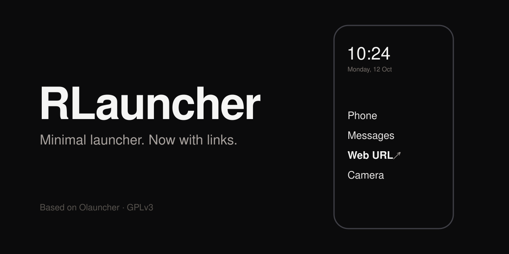

# RLauncher

Minimaler Android-Launcher – ein Fork von [Olauncher](https://github.com/tanujnotes/Olauncher), fast unverändert.
Neu ist genau eine Funktion: **Links als Einträge in der App-Liste**, die sich wie Apps verhalten.

## Links (Web-Verknüpfungen)

Ein Link ist ein Eintrag in der App-Liste, der eine Webseite im Standardbrowser (z. B. Firefox) öffnet.
Er sieht aus wie eine App und lässt sich genauso benutzen: antippen, umbenennen, löschen, auf die Startseite legen oder einer Wischgeste zuweisen.

### Link anlegen

1. Auf der Startseite lange drücken → **Einstellungen**.
2. Ganz oben **Link hinzufügen** antippen.
3. **Name** eingeben (z. B. `Wikipedia`) und **URL** (z. B. `wikipedia.org`) → **OK**.

Der Link erscheint sofort in der App-Liste.

- `https://` ist optional – bei `wikipedia.org` wird es automatisch ergänzt. `http://` bleibt erhalten, wenn du es angibst.
- Bleibt der Name leer, wird die Domain verwendet (`wikipedia.org`).
- Alternativ: In der App-Suche eine URL tippen und **Enter** drücken. Weil die Suche eine App automatisch öffnet, sobald nur noch ein Treffer übrig ist, klappt das nicht bei jeder URL – der Weg über die Einstellungen funktioniert immer.

### Link benutzen und ändern

| Aktion | So geht's |
|---|---|
| Öffnen | Eintrag in der App-Liste antippen → öffnet im Standardbrowser |
| URL ändern | Eintrag lange drücken → **URL** |
| Umbenennen | Eintrag lange drücken → **Umbenennen** |
| Löschen | Eintrag lange drücken → **Löschen** |
| Auf die Startseite | Auf der Startseite lange auf einen Platz drücken → Link aus der Liste wählen |
| Wischgeste | Einstellungen → Wischen nach links/rechts → Link wählen |

### Voraussetzungen

- **RLauncher muss Standard-Launcher sein.** Nur der Standard-Launcher darf Verknüpfungen anlegen; sonst erscheint „Verknüpfung konnte nicht hinzugefügt werden“.
- Android 8.0 oder neuer.

### Wie es technisch funktioniert

Links werden als angeheftete Android-Shortcuts von RLauncher selbst gespeichert (`Intent.ACTION_VIEW` mit der URL).
Dadurch nutzen sie die vorhandene Shortcut-Logik von Olauncher für Liste, Start, Umbenennen, Löschen und Startseite.
Wird RLauncher deinstalliert, sind die Links weg.

## Unterschiede zu Olauncher

- Links in der App-Liste (siehe oben)
- App-ID `app.rlauncher` – läuft parallel zu einem installierten Olauncher
- Name RLauncher in der App
- Kein Werbe-Dialog für die Pro-Version

## Installation

Es gibt keine Store-Version. APK selbst bauen (JDK 17 und Android SDK nötig):

```sh
./gradlew assembleDebug
adb install -r app/build/outputs/apk/debug/app-debug.apk
```

Ohne Kabel: `app-debug.apk` aufs Handy kopieren, antippen und „Unbekannte Apps installieren“ erlauben.
Danach unter **Einstellungen → Apps → Standard-Apps → Startbildschirm-App** RLauncher wählen.

## Credits & Lizenz

RLauncher basiert auf [Olauncher](https://github.com/tanujnotes/Olauncher) von [tanujnotes](https://github.com/tanujnotes) – alle übrigen Funktionen und das Design stammen von dort.

Lizenz: [GNU GPLv3](LICENSE)
